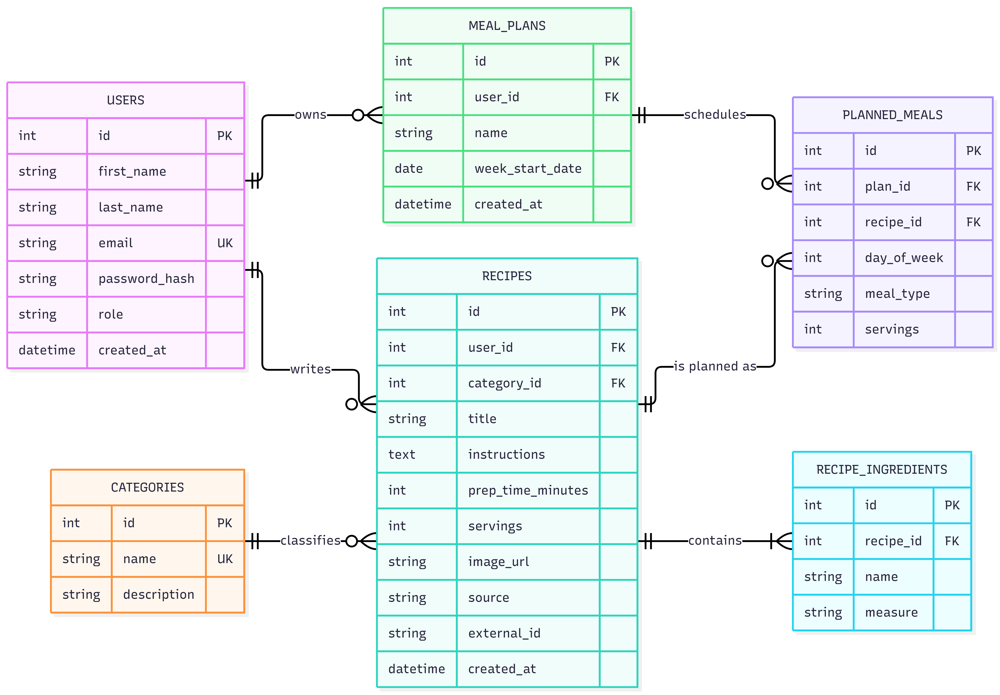

# ForkCast

**Plan your week, one plate at a time.**

ForkCast is a single-page web application for planning meals. Users save recipes (their own or imported from TheMealDB), arrange them in a weekly meal plan, and get a shopping list built from the ingredients of the planned meals.

> **Status:** Milestone 3 completed (services, REST API with FlightPHP, OpenAPI documentation and the TheMealDB integration). Authentication with JWT, middleware, logging of every request and the connected frontend arrive in Milestone 4, so the web pages still show static sample data. Sections marked `TODO` are filled in as the milestones are completed.

## Features

- Browse, search and filter recipes by category
- Create, edit and delete your own recipes with a dynamic ingredient list
- Discover recipes from TheMealDB and import them into your collection
- Build a weekly plan (day x breakfast / lunch / dinner / snack)
- Generate a shopping list from the planned meals
- Role-based access: users manage their own content, admins manage everything

## Technology stack

| Part | Technology |
|---|---|
| Frontend | HTML, CSS, JavaScript, jQuery 3.7.1, Bootstrap 5.3.3, single-page application with a hash router |
| Backend | PHP, FlightPHP (REST API, installed with Composer), PDO |
| Database | MySQL (MariaDB in XAMPP) |
| API documentation | OpenAPI (swagger-php attributes) and Swagger UI |
| Authentication | JWT (Milestone 4) |
| External API | TheMealDB |
| Local server | XAMPP (Apache + MySQL) |

## Entities and relationships

| Entity | Description |
|---|---|
| `users` | Registered people, with a role (`admin` or `user`) |
| `categories` | Recipe categories (Beef, Dessert, Vegan, ...) |
| `recipes` | Recipes written by users or imported from TheMealDB |
| `recipe_ingredients` | The ingredients (name and measure) of a recipe |
| `meal_plans` | A user's plan for one week |
| `planned_meals` | One recipe placed in one slot (day and meal type) of a plan |

**Relationships**

- A user writes many recipes (1:N).
- A category contains many recipes (1:N).
- A recipe has many ingredients (1:N).
- A user owns many meal plans (1:N).
- A meal plan contains many planned meals (1:N).
- A recipe can be planned many times (1:N). Through `planned_meals`, plans and recipes form a many-to-many relationship.

The full Entity-Relationship Diagram of this project, with constraints and deletion rules in [docs/ERD.md](docs/ERD.md):



## Database

The schema and the sample data are in [backend/database/forkcast.sql](backend/database/forkcast.sql). It creates the `forkcast` database with these 6 tables (InnoDB, utf8mb4).

**Constraints**

- Unique: `users.email`, `categories.name`, (`recipes.user_id`, `recipes.external_id`), (`meal_plans.user_id`, `meal_plans.week_start_date`) and (`planned_meals.plan_id`, `planned_meals.day_of_week`, `planned_meals.meal_type`).
- Checks: `recipes.prep_time_minutes` between 1 and 600, `recipes.servings` between 1 and 20, `planned_meals.day_of_week` between 1 and 7.
- Deleting a user, a recipe or a plan also deletes what belongs to it (`ON DELETE CASCADE`). A category that has recipes, and a recipe used in a plan, cannot be deleted (`ON DELETE RESTRICT`).

**Sample data:** 3 users, 14 categories (the TheMealDB category names), 8 recipes with ingredients, 2 meal plans and 8 planned meals.

## Backend architecture

Every request follows the same path:

```
request -> .htaccess -> index.php -> route -> service -> DAO -> database
                                                |
                                  response (JSON) <- route
```

| Layer | Folder | Responsibility |
|---|---|---|
| Entry point | `backend/index.php` | Starts FlightPHP, loads the routes, turns exceptions into JSON errors |
| Routes | `backend/routes/` | Identify the caller, read the JSON body, call one service method, return JSON with the right status code. No SQL. |
| Services | `backend/services/` | Validation, access rules and business rules. The only layer that calls DAOs. |
| DAO | `backend/dao/` | SQL with PDO prepared statements only, no business logic |
| Support | `backend/exceptions/`, `backend/middleware/` | `ApiException`, `CurrentUser` (temporary identification) and `Logger` |

**Services:** `UserService`, `CategoryService`, `RecipeService`, `RecipeIngredientService`, `MealPlanService`, `PlannedMealService` and `MealDbService` (the external API). `Validator` and `Access` are shared helpers for input validation and ownership/role checks.

**Business rules**

- Only the owner of a recipe or an admin can edit or delete it.
- A recipe used in a plan cannot be deleted; a category with recipes cannot be deleted.
- Creating or changing a recipe and its ingredients happens in one database transaction.
- The last ingredient of a recipe cannot be deleted.
- A plan starts on a Monday; one plan per user per week.
- One meal per plan slot (day and meal type).
- Importing the same TheMealDB meal twice returns the existing recipe.

## REST API

The full specification is in [docs/API.md](docs/API.md), and the interactive documentation is the Swagger page (see below). All requests and responses are JSON. Lists accept `limit` (default 20, maximum 100) and `offset`, except `GET /categories`, which returns every category.

**Status codes**

| Code | Meaning |
|---|---|
| 200 | OK (GET, PUT, DELETE) |
| 201 | Created (POST) |
| 400 | Invalid input or a business rule is violated |
| 401 | No identified user |
| 403 | The user is not allowed to do this |
| 404 | Not found |
| 500 | Unexpected error (generic message, details only in the error log) |
| 503 | TheMealDB is unavailable |

Errors look like `{"error": "message"}`, and validation errors add `"errors": {"field": "message"}`. Responses never contain stack traces, SQL or file paths.

**Temporary identification:** until JWT is added in Milestone 4, the caller is identified by the header `X-User-Id` (the id of an existing user, for example `1` for the admin). A missing or unknown id gives 401, and the role is always read from the database. This is replaced by JWT authentication in Milestone 4.

### Endpoints (33)

**Users**

| Method | Path | Access |
|---|---|---|
| GET | `/users` | admin |
| GET | `/users/{id}` | self or admin |
| POST | `/users` | public (registration) |
| PUT | `/users/{id}` | self or admin |
| DELETE | `/users/{id}` | admin |

**Categories**

| Method | Path | Access |
|---|---|---|
| GET | `/categories` | user |
| GET | `/categories/{id}` | user |
| POST | `/categories` | admin |
| PUT | `/categories/{id}` | admin |
| DELETE | `/categories/{id}` | admin |

**Recipes and ingredients**

| Method | Path | Access |
|---|---|---|
| GET | `/recipes` (query: `search`, `category_id`, `mine`, `limit`, `offset`) | user |
| GET | `/recipes/{id}` | user |
| POST | `/recipes` | user |
| PUT | `/recipes/{id}` | owner or admin |
| DELETE | `/recipes/{id}` | owner or admin |
| POST | `/recipes/import/{externalId}` | user |
| GET | `/recipes/{id}/ingredients` | user |
| POST | `/recipes/{id}/ingredients` | owner or admin |
| PUT | `/ingredients/{id}` | owner or admin |
| DELETE | `/ingredients/{id}` | owner or admin |

**Meal plans and planned meals**

| Method | Path | Access |
|---|---|---|
| GET | `/plans` | user (own plans; admin sees all) |
| GET | `/plans/{id}` | owner or admin |
| POST | `/plans` | user |
| PUT | `/plans/{id}` | owner or admin |
| DELETE | `/plans/{id}` | owner or admin |
| GET | `/plans/{id}/shopping-list` | owner or admin |
| GET | `/plans/{id}/meals` | owner or admin |
| POST | `/plans/{id}/meals` | owner or admin |
| PUT | `/planned-meals/{id}` | owner or admin |
| DELETE | `/planned-meals/{id}` | owner or admin |

**External API (TheMealDB)**

| Method | Path | Access |
|---|---|---|
| GET | `/external/meals/search` (exactly one of `q`, `category`, `area`, `ingredient`) | user |
| GET | `/external/meals/random` | user |
| GET | `/external/meals/{id}` | user |

`GET /` returns the API name and version.

## API documentation (Swagger)

Every endpoint is documented with OpenAPI. Start Apache and open:

**http://localhost/forkcast/ForkCast/backend/swagger/**

Click **Authorize**, enter `1` (admin) or `2` (user) as the `X-User-Id`, and use **Try it out** on any endpoint.

The documentation is written as PHP attributes in `backend/openapi/` and the specification file is generated into `backend/swagger/openapi.json`. To regenerate it after a change (needs PHP 8.1 or newer):

```powershell
cd backend
composer dump-autoload
composer docs
```

## Roles and test accounts

| Role | Permissions |
|---|---|
| **user** | Browse all recipes; create, edit and delete own recipes; import from TheMealDB; manage own meal plans and shopping lists; edit own profile |
| **admin** | Everything a user can do, plus manage categories and users, and edit or delete any recipe |

The sample accounts below are in the database. Until login arrives in Milestone 4, use their **ids** with the `X-User-Id` header instead.

| Role | Id | Email | Password |
|---|---|---|---|
| admin | 1 | admin@forkcast.test | Admin123! |
| user | 2 | user1@forkcast.test | User123! |
| user | 3 | user2@forkcast.test | User123! |

These are demo passwords for local testing only.

## External API: TheMealDB

[TheMealDB](https://www.themealdb.com/api.php) is a free recipe database. The frontend never calls it directly. The ForkCast backend calls it and passes the result on.

**Endpoints used:** `search.php?s=` (search by name), `filter.php?c=`, `filter.php?a=` and `filter.php?i=` (filter by category, area or main ingredient), `lookup.php?i=` (full details of one meal) and `random.php` (random meal).

**Features it supports**

- **Discover:** search meals by name, category, area or main ingredient, or get a random meal ("Surprise me")
- **Import:** `POST /recipes/import/{externalId}` saves a TheMealDB meal as a ForkCast recipe with all its ingredients. The category is matched by name (and created if missing). TheMealDB has no preparation time or servings, so imported recipes get 30 minutes and 4 servings.
- **Meal of the day:** a random meal for the home page

**Error handling:** requests have a 5 second timeout (3 seconds to connect). TheMealDB returns `{"meals": null}` when nothing is found, which becomes an empty list for searches and a 404 for a lookup. If the service is unavailable, returns an error or invalid data, the failure is written to the error log, the API answers 503 with a friendly message, and the rest of the application keeps working.

**Configuration:** the base URL, the API key and the timeout are in `backend/config/config.php` and are not committed to the repository.

**Logging:** `backend/logs/error.log` receives unexpected errors and external API failures, and `backend/logs/info.log` receives successful external API calls. Request logging is added in Milestone 4.

## Running the project locally

**Requirements:** XAMPP (Apache, MySQL, PHP with the `pdo_mysql`, `curl` and `openssl` extensions, all enabled by default), [Composer](https://getcomposer.org/) and Git.

1. Start **Apache** and **MySQL** in the XAMPP Control Panel.
2. Clone the repository into a folder named `forkcast` inside `htdocs`. This gives the URLs used in this README:

   ```powershell
   mkdir C:\xampp\htdocs\forkcast
   cd C:\xampp\htdocs\forkcast
   git clone https://github.com/andrejlubura-rgb/ForkCast.git
   ```

   If you use another folder, change the `RewriteBase` line in `backend/.htaccess` and the URLs below to match.
3. **Install the backend packages** (the `vendor/` folder is not committed):

   ```powershell
   cd ForkCast\backend
   composer install
   ```

4. **Import the database:**
   1. Open phpMyAdmin at `http://localhost/phpmyadmin`.
   2. Go to **Import**, choose `backend/database/forkcast.sql` and click **Go**.
   3. The file creates the `forkcast` database and fills it with sample data. Importing it again resets the data in those tables.
5. **Create the configuration file:**

   ```powershell
   Copy-Item config\config.example.php config\config.php
   ```

   Open `backend/config/config.php` and check the database settings. The XAMPP defaults (host `localhost`, user `root`, empty password, database `forkcast`) work without changes. The TheMealDB key `1` is TheMealDB's public test key. The JWT secret is used from Milestone 4. `config.php` is excluded from Git and must never be committed.
6. **Run the checks** (from the `ForkCast` folder). Every line should print `PASS`:

   ```powershell
   C:\xampp\php\php.exe backend\tests\dao_smoke_test.php
   C:\xampp\php\php.exe backend\tests\api_smoke_test.php
   ```

   `dao_smoke_test.php` tests the database layer inside a transaction that is rolled back. `api_smoke_test.php` calls the running API (so Apache must be running), checks the status codes and removes the data it created. If TheMealDB is unreachable, its external checks print `SKIP`.
7. Open the application:
   - API: `http://localhost/forkcast/ForkCast/backend/`
   - API documentation: `http://localhost/forkcast/ForkCast/backend/swagger/`
   - Frontend: `http://localhost/forkcast/ForkCast/frontend/` (static pages, not yet connected to the API)

**Trying the API from the command line:**

```powershell
$base = "http://localhost/forkcast/ForkCast/backend"
curl.exe -i -H "X-User-Id: 2" "$base/categories"            # 200
curl.exe -i "$base/categories"                              # 401, no user
curl.exe -i -H "X-User-Id: 2" "$base/users"                 # 403, admin only
curl.exe -i -H "X-User-Id: 2" "$base/external/meals/search?q=chicken"
```

## Deployed application

TODO (Milestone 5): link to the live application.

## Project structure

```
ForkCast/
├── .agents/
│   └── skills/
│       └── update-ai-log/
│           └── SKILL.md              # AI skill that writes entries to the AI log
├── .github/
│   └── agents/                       # AI agent definitions (Copilot format)
│       ├── backend.agent.md
│       ├── frontend.agent.md
│       └── reviewer.agent.md
├── .opencode/
│   ├── agents/                       # AI agent definitions (OpenCode format)
│   │   ├── backend.md
│   │   ├── frontend.md
│   │   └── reviewer.md
│   └── skills/
│       └── update-ai-log/
│           └── SKILL.md              # same skill, in OpenCode's own folder
├── backend/                          # PHP REST API
│   ├── config/
│   │   └── config.example.php        # configuration template; config.php is not committed
│   ├── dao/                          # database access with PDO
│   │   ├── Database.php              # one shared PDO connection
│   │   ├── BaseDao.php               # reusable CRUD methods and transactions
│   │   ├── UserDao.php
│   │   ├── CategoryDao.php
│   │   ├── RecipeDao.php
│   │   ├── RecipeIngredientDao.php
│   │   ├── MealPlanDao.php
│   │   └── PlannedMealDao.php
│   ├── database/
│   │   └── forkcast.sql              # schema and sample data (import into MySQL)
│   ├── exceptions/
│   │   └── ApiException.php          # errors with an HTTP status
│   ├── logs/                         # info.log and error.log (not committed)
│   ├── middleware/
│   │   ├── CurrentUser.php           # temporary identification (X-User-Id), replaced by JWT in Milestone 4
│   │   └── Logger.php                # info and error log writer
│   ├── openapi/                      # OpenAPI attribute classes (API documentation source)
│   │   ├── OpenApiSpec.php
│   │   ├── UserApi.php
│   │   ├── CategoryApi.php
│   │   ├── RecipeApi.php
│   │   ├── IngredientApi.php
│   │   ├── MealPlanApi.php
│   │   ├── PlannedMealApi.php
│   │   └── ExternalApi.php
│   ├── routes/                       # FlightPHP route files
│   │   ├── helpers.php               # jsonBody() and shared helpers
│   │   ├── users.php
│   │   ├── categories.php
│   │   ├── recipes.php
│   │   ├── ingredients.php
│   │   ├── plans.php
│   │   ├── planned_meals.php
│   │   └── external.php
│   ├── services/                     # business logic
│   │   ├── Validator.php
│   │   ├── Access.php
│   │   ├── UserService.php
│   │   ├── CategoryService.php
│   │   ├── RecipeService.php
│   │   ├── RecipeIngredientService.php
│   │   ├── MealPlanService.php
│   │   ├── PlannedMealService.php
│   │   └── MealDbService.php         # TheMealDB client
│   ├── swagger/
│   │   ├── index.html                # Swagger UI page
│   │   └── openapi.json              # generated OpenAPI specification
│   ├── tests/
│   │   ├── dao_smoke_test.php        # command-line test of all DAO classes
│   │   └── api_smoke_test.php        # command-line test of the REST API
│   ├── .htaccess                     # sends requests to index.php
│   ├── bootstrap.php                 # class autoloader
│   ├── composer.json
│   ├── composer.lock
│   └── index.php                     # API entry point
├── docs/
│   ├── AI_LOG.md                     # AI usage log, one section per milestone
│   ├── API.md                        # specification of every endpoint
│   ├── ERD.md                        # ER diagram with constraints
│   └── ERD.png                       # ER diagram image
├── frontend/                         # HTML, CSS and JavaScript (single-page app)
│   ├── assets/
│   │   └── images/
│   ├── css/
│   │   └── style.css
│   ├── js/
│   │   ├── services/                 # AJAX calls to the API (Milestone 4)
│   │   ├── app.js                    # application entry point
│   │   ├── home.js
│   │   ├── navbar.js
│   │   └── router.js                 # hash router: loads each view once
│   ├── views/                        # one HTML fragment per page
│   │   ├── 404.html
│   │   ├── admin-categories.html
│   │   ├── admin-users.html
│   │   ├── discover.html
│   │   ├── home.html
│   │   ├── login.html
│   │   ├── planner.html
│   │   ├── profile.html
│   │   ├── recipe-form.html
│   │   ├── recipe.html
│   │   ├── recipes.html
│   │   └── register.html
│   └── index.html                    # application shell: navbar, #app, footer
├── .gitignore
├── AGENTS.md                         # rules and context for AI coding assistants
├── opencode.json                     # OpenCode permission settings
└── README.md
```

## AI usage

AI tools were used during development under the rules in [AGENTS.md](AGENTS.md). Each milestone's usage, prompts and cases where the AI was wrong are documented in [docs/AI_LOG.md](docs/AI_LOG.md).