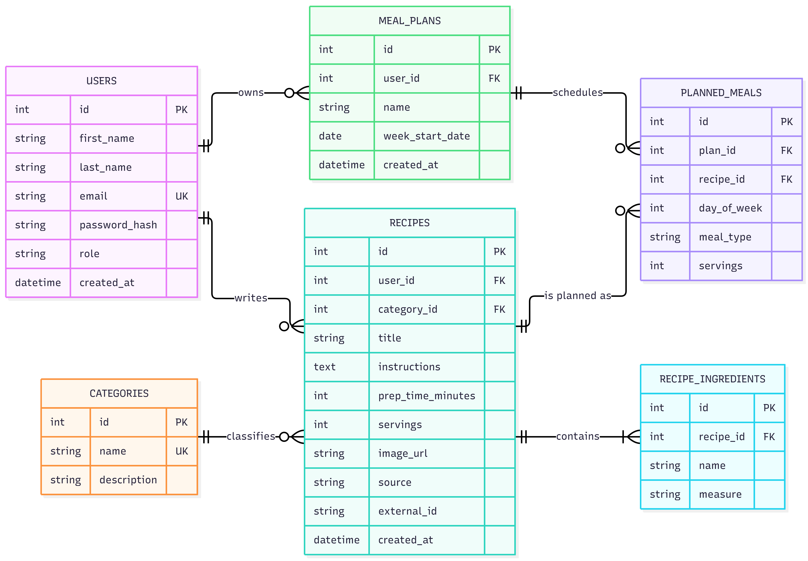

# ForkCast

**Plan your week, one plate at a time.**

ForkCast is a single-page web application for planning meals. Users save recipes (their own or imported from TheMealDB), arrange them in a weekly meal plan, and get a shopping list built from the ingredients of the planned meals.

> **Status:** Milestone 2 completed (database schema, sample data and DAO layer). The REST API (Milestone 3) and authentication (Milestone 4) are not implemented yet, so the web pages still show static sample data. Sections marked `TODO` are filled in as the milestones are completed.

## Features

- Browse, search and filter recipes by category
- Create, edit and delete your own recipes with a dynamic ingredient list
- Discover recipes from TheMealDB and import them into your collection
- Build a weekly plan (day x breakfast / lunch / dinner / snack)
- Generate a shopping list from the planned meals
- Role-based access: users manage their own content, admins manage everything

## Technology stack

| Part | Technology |
|---|---|
| Frontend | HTML, CSS, JavaScript, jQuery 3.7.1, Bootstrap 5.3.3, single-page application with a hash router |
| Backend | PHP, FlightPHP (REST API), PDO |
| Database | MySQL (MariaDB in XAMPP) |
| Authentication | JWT |
| External API | TheMealDB |
| Local server | XAMPP (Apache + MySQL) |

## Entities and relationships

| Entity | Description |
|---|---|
| `users` | Registered people, with a role (`admin` or `user`) |
| `categories` | Recipe categories (Beef, Dessert, Vegan, ...) |
| `recipes` | Recipes written by users or imported from TheMealDB |
| `recipe_ingredients` | The ingredients (name and measure) of a recipe |
| `meal_plans` | A user's plan for one week |
| `planned_meals` | One recipe placed in one slot (day and meal type) of a plan |

**Relationships**

- A user writes many recipes (1:N).
- A category contains many recipes (1:N).
- A recipe has many ingredients (1:N).
- A user owns many meal plans (1:N).
- A meal plan contains many planned meals (1:N).
- A recipe can be planned many times (1:N). Through `planned_meals`, plans and recipes form a many-to-many relationship.

The full Entity-Relationship Diagram of this project, with constraints and deletion rules in [docs/ERD.md](docs/ERD.md):



## Database

The schema is in [backend/database/forkcast.sql](backend/database/forkcast.sql), together with the sample data. It creates the `forkcast` database with these 6 tables (InnoDB, utf8mb4).

**Constraints**

- Unique: `users.email`, `categories.name`, (`recipes.user_id`, `recipes.external_id`), (`meal_plans.user_id`, `meal_plans.week_start_date`) and (`planned_meals.plan_id`, `planned_meals.day_of_week`, `planned_meals.meal_type`).
- Checks: `recipes.prep_time_minutes` between 1 and 600, `recipes.servings` between 1 and 20, `planned_meals.day_of_week` between 1 and 7.
- Deleting a user, a recipe or a plan also deletes what belongs to it (`ON DELETE CASCADE`). A category that has recipes, and a recipe used in a plan, cannot be deleted (`ON DELETE RESTRICT`).

**Sample data:** 3 users, 14 categories (the TheMealDB category names), 8 recipes with ingredients, 2 meal plans and 8 planned meals.

## Backend: DAO layer

The DAO (data access) classes in `backend/dao/` are the only code that talks to the database. They use PDO prepared statements with bound parameters, and contain no business rules.

- `Database` creates one shared PDO connection from `backend/config/config.php`.
- `BaseDao` provides the reusable methods `getAll`, `getById`, `insert`, `update` and `delete`. Each DAO declares a whitelist of columns that `insert` and `update` may write.
- Every entity has its own DAO class that extends `BaseDao`:

| Class | Table | Extra methods |
|---|---|---|
| `UserDao` | `users` | `getByEmail`, `getAllPublic` |
| `CategoryDao` | `categories` | `getByName`, `countRecipes` |
| `RecipeDao` | `recipes` | `search`, `getByIdWithDetails`, `getByExternalId` |
| `RecipeIngredientDao` | `recipe_ingredients` | `getByRecipeId`, `deleteByRecipeId` |
| `MealPlanDao` | `meal_plans` | `getByUserId`, `getByUserAndWeek` |
| `PlannedMealDao` | `planned_meals` | `getByPlanId`, `getBySlot`, `countByRecipeId`, `getShoppingList` |

In the next milestones, services will call these classes and FlightPHP routes will call the services.

## Roles and test accounts

| Role | Permissions |
|---|---|
| **user** | Browse all recipes; create, edit and delete own recipes; import from TheMealDB; manage own meal plans and shopping lists; edit own profile |
| **admin** | Everything a user can do, plus manage categories and users, and edit or delete any recipe |

The sample accounts below are already in the database, but you can only log in with them from Milestone 4, when authentication is implemented.

| Role | Email | Password |
|---|---|---|
| admin | admin@forkcast.test | Admin123! |
| user | user1@forkcast.test | User123! |
| user | user2@forkcast.test | User123! |

These are demo passwords for local testing only.

## External API: TheMealDB

[TheMealDB](https://www.themealdb.com/api.php) is a free recipe database. The frontend never calls it directly. The ForkCast backend calls it and passes the result on.

**Features it supports**

- **Discover:** search meals by name, category, area or main ingredient, or get a random meal ("Surprise me")
- **Import:** save a TheMealDB meal as a ForkCast recipe, including its ingredients
- **Meal of the day:** a random meal shown on the home page

**Error handling:** requests have a 5 second timeout. If TheMealDB is unavailable or returns an error, the failure is written to the error log, the user sees a friendly message, and the rest of the application keeps working.

Endpoints used: TODO (Milestone 3). The API key is stored in the configuration file and is not committed to the repository.

## Running the project locally

**Requirements:** XAMPP with PHP 7.4 or newer (the `pdo_mysql` extension is enabled by default). No Composer is needed yet.

1. Install [XAMPP](https://www.apachefriends.org/) and start **Apache** and **MySQL** in the XAMPP Control Panel.
2. Clone the repository into the `htdocs` folder:

   ```powershell
   cd C:\xampp\htdocs
   git clone https://github.com/andrejlubura-rgb/ForkCast.git
   ```

3. **Import the database:**
   1. Open phpMyAdmin at `http://localhost/phpmyadmin`.
   2. Go to **Import**, choose `backend/database/forkcast.sql` and click **Go**.
   3. The file creates the `forkcast` database and fills it with sample data. Importing it again resets the data in those tables.
4. **Create the configuration file:**
   1. Copy `backend/config/config.example.php` to `backend/config/config.php`:

      ```powershell
      Copy-Item backend\config\config.example.php backend\config\config.php
      ```

   2. Open `config.php` and check the database settings. The XAMPP defaults (host `localhost`, user `root`, empty password, database `forkcast`) work without changes. The JWT secret and the TheMealDB API key are used in later milestones.
   3. `config.php` is excluded from Git and must never be committed.
5. **Check the database layer.** The smoke test runs every DAO method inside a transaction and rolls it back, so it does not change your data:

   ```powershell
   C:\xampp\php\php.exe backend\tests\dao_smoke_test.php
   ```

   Every line should print `PASS`.
6. Open the application at `http://localhost/ForkCast/frontend/`.
   (Adjust the path if you cloned into a different folder. The pages are loaded with AJAX, so opening `index.html` directly from the file system does not work. The pages do not use the database yet.)

## API documentation (Swagger)

TODO (Milestone 3): link to the Swagger UI page.

## Deployed application

TODO (Milestone 5): link to the live application.

## Project structure

```
ForkCast/
├── .agents/
│   └── skills/
│       └── update-ai-log/
│           └── SKILL.md              # AI skill that writes entries to the AI log
├── .github/
│   └── agents/                       # AI agent definitions (Copilot format)
│       ├── backend.agent.md
│       ├── frontend.agent.md
│       └── reviewer.agent.md
├── .opencode/
│   ├── agents/                       # AI agent definitions (OpenCode format)
│   │   ├── backend.md
│   │   ├── frontend.md
│   │   └── reviewer.md
│   └── skills/
│       └── update-ai-log/
│           └── SKILL.md              # same skill, in OpenCode's own folder
├── backend/                          # PHP REST API (Milestones 2-4)
│   ├── config/
│   │   └── config.example.php        # configuration template; config.php is not committed
│   ├── dao/                          # database access with PDO
│   │   ├── Database.php              # one shared PDO connection
│   │   ├── BaseDao.php               # reusable CRUD methods
│   │   ├── UserDao.php
│   │   ├── CategoryDao.php
│   │   ├── RecipeDao.php
│   │   ├── RecipeIngredientDao.php
│   │   ├── MealPlanDao.php
│   │   └── PlannedMealDao.php
│   ├── database/
│   │   └── forkcast.sql              # schema and sample data (import into MySQL)
│   ├── logs/                         # info.log and error.log (not committed)
│   ├── middleware/                   # JWT auth, roles, request logging, error handling (Milestone 4)
│   ├── routes/                       # FlightPHP routes (Milestone 3)
│   ├── services/                     # business logic (Milestone 3)
│   ├── tests/
│   │   └── dao_smoke_test.php        # command-line test of all DAO classes
│   └── bootstrap.php                 # class autoloader
├── docs/
│   ├── AI_LOG.md                     # AI usage log, one section per milestone
│   ├── ERD.md                        # ER diagram with constraints
│   └── ERD.png                       # ER diagram image
├── frontend/                         # HTML, CSS and JavaScript (single-page app)
│   ├── assets/
│   │   └── images/
│   ├── css/
│   │   └── style.css
│   ├── js/
│   │   ├── services/                 # AJAX calls to the API (Milestone 4)
│   │   ├── app.js                    # application entry point
│   │   ├── home.js
│   │   ├── navbar.js
│   │   └── router.js                 # hash router: loads each view once
│   ├── views/                        # one HTML fragment per page
│   │   ├── 404.html
│   │   ├── admin-categories.html
│   │   ├── admin-users.html
│   │   ├── discover.html
│   │   ├── home.html
│   │   ├── login.html
│   │   ├── planner.html
│   │   ├── profile.html
│   │   ├── recipe-form.html
│   │   ├── recipe.html
│   │   ├── recipes.html
│   │   └── register.html
│   └── index.html                    # application shell: navbar, #app, footer
├── .gitignore
├── AGENTS.md                         # rules and context for AI coding assistants
├── opencode.json                     # OpenCode permission settings
└── README.md
```

## AI usage

AI tools were used during development under the rules in [AGENTS.md](AGENTS.md). Each milestone's usage, prompts and cases where the AI was wrong are documented in [docs/AI_LOG.md](docs/AI_LOG.md).