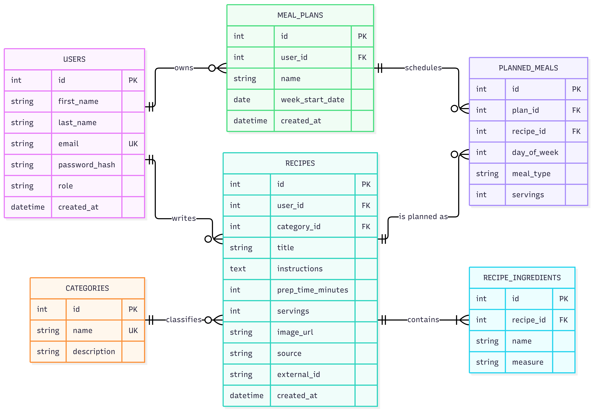

# ForkCast

**Plan your week, one plate at a time.**

ForkCast is a single-page web application for planning meals. Users save recipes (their own or imported from TheMealDB), arrange them in a weekly meal plan, and get a shopping list built from the ingredients of the planned meals.

> **Status:** Milestone 1 (project structure, static frontend, ERD draft). Sections marked `TODO` are filled in as the milestones are completed.

## Features

- Browse, search and filter recipes by category
- Create, edit and delete your own recipes with a dynamic ingredient list
- Discover recipes from TheMealDB and import them into your collection
- Build a weekly plan (day x breakfast / lunch / dinner / snack)
- Generate a shopping list from the planned meals
- Role-based access: users manage their own content, admins manage everything

## Technology stack

| Part | Technology |
|---|---|
| Frontend | HTML, CSS, JavaScript, jQuery 3.7.1, Bootstrap 5.3.3, single-page application with a hash router |
| Backend | PHP, FlightPHP (REST API), PDO |
| Database | MySQL |
| Authentication | JWT |
| External API | TheMealDB |
| Local server | XAMPP (Apache + MySQL) |

## Entities and relationships

| Entity | Description |
|---|---|
| `users` | Registered people, with a role (`admin` or `user`) |
| `categories` | Recipe categories (Beef, Dessert, Vegan, ...) |
| `recipes` | Recipes written by users or imported from TheMealDB |
| `recipe_ingredients` | The ingredients (name and measure) of a recipe |
| `meal_plans` | A user's plan for one week |
| `planned_meals` | One recipe placed in one slot (day and meal type) of a plan |

**Relationships**

- A user writes many recipes (1:N).
- A category contains many recipes (1:N).
- A recipe has many ingredients (1:N).
- A user owns many meal plans (1:N).
- A meal plan contains many planned meals (1:N).
- A recipe can be planned many times (1:N). Through `planned_meals`, plans and recipes form a many-to-many relationship.

The full Entity-Relationship Diagram of this project:



## Roles and test accounts

| Role | Permissions |
|---|---|
| **user** | Browse all recipes; create, edit and delete own recipes; import from TheMealDB; manage own meal plans and shopping lists; edit own profile |
| **admin** | Everything a user can do, plus manage categories and users, and edit or delete any recipe |

| Role | Email | Password |
|---|---|---|
| admin | TODO (Milestone 4) | TODO (Milestone 4) |
| user | TODO (Milestone 4) | TODO (Milestone 4) |

## External API: TheMealDB

[TheMealDB](https://www.themealdb.com/api.php) is a free recipe database. The frontend never calls it directly. The ForkCast backend calls it and passes the result on.

**Features it supports**

- **Discover:** search meals by name, category, area or main ingredient, or get a random meal ("Surprise me")
- **Import:** save a TheMealDB meal as a ForkCast recipe, including its ingredients
- **Meal of the day:** a random meal shown on the home page

**Error handling:** requests have a 5 second timeout. If TheMealDB is unavailable or returns an error, the failure is written to the error log, the user sees a friendly message, and the rest of the application keeps working.

Endpoints used: TODO (Milestone 3). The API key is stored in the configuration file and is not committed to the repository.

## Running the project locally

> The backend and database arrive in Milestones 2-4. Steps marked `TODO` do not work yet.

1. Install [XAMPP](https://www.apachefriends.org/) and start **Apache** and **MySQL** in the XAMPP Control Panel.
2. Clone the repository into the `htdocs` folder:

   ```bash
   cd C:\xampp\htdocs
   git clone https://github.com/andrejlubura-rgb/ForkCast.git
   ```

3. **Import the database** (TODO, Milestone 2):
   1. Open phpMyAdmin at `http://localhost/phpmyadmin`.
   2. Create a database named `TODO (Milestone 2)`.
   3. Import the `.sql` file from the repository (`TODO (Milestone 2)`).
4. **Create the configuration file** (TODO, Milestone 2):
   1. Copy `backend/config/config.example.php` to `backend/config/config.php`.
   2. Fill in your database credentials, a JWT secret and the TheMealDB API key.
   3. `config.php` is excluded from Git and must never be committed.
5. Open the application at `http://localhost/ForkCast/frontend/`.
   (Adjust the path if you cloned into a different folder. The pages are loaded with AJAX, so opening `index.html` directly from the file system does not work.)

## API documentation (Swagger)

TODO (Milestone 3): link to the Swagger UI page.

## Deployed application

TODO (Milestone 5): link to the live application.

## Project structure

```
ForkCast/
├── .agents/
│   └── skills/
│       └── update-ai-log/
│           └── SKILL.md          # AI skill that writes entries to the AI log
├── .github/
│   └── agents/                   # AI agent definitions (Copilot format)
│       ├── backend.agent.md
│       ├── frontend.agent.md
│       └── reviewer.agent.md
├── ├── .opencode/
│   ├── agents/                   # AI agent definitions (OpenCode format)
│   │   ├── backend.md
│   │   ├── frontend.md
│   │   └── reviewer.md
│   └── skills/
│       └── update-ai-log/
│           └── SKILL.md          # same skill, in OpenCode's own folder
├── backend/                      # PHP REST API (Milestones 2-4)
│   ├── config/                   # config.example.php; config.php is not committed
│   ├── dao/                      # database access with PDO
│   ├── logs/                     # info.log and error.log (not committed)
│   ├── middleware/               # JWT auth, roles, request logging, error handling
│   ├── routes/                   # FlightPHP routes
│   └── services/                 # business logic
├── docs/
│   ├── AI_LOG.md                 # AI usage log, one section per milestone
│   └── ERD.png                   # ER diagram image
├── frontend/                     # HTML, CSS and JavaScript (single-page app)
│   ├── assets/
│   │   └── images/
│   ├── css/
│   │   └── style.css
│   ├── js/
│   │   ├── services/             # AJAX calls to the API (Milestone 4)
│   │   ├── app.js                # application entry point
│   │   ├── home.js
│   │   ├── navbar.js
│   │   └── router.js             # hash router: loads each view once
│   ├── views/                    # one HTML fragment per page
│   │   ├── 404.html
│   │   ├── admin-categories.html
│   │   ├── admin-users.html
│   │   ├── discover.html
│   │   ├── home.html
│   │   ├── login.html
│   │   ├── planner.html
│   │   ├── profile.html
│   │   ├── recipe-form.html
│   │   ├── recipe.html
│   │   ├── recipes.html
│   │   └── register.html
│   └── index.html                # application shell: navbar, #app, footer
├── .gitignore
├── AGENTS.md                     # rules and context for AI coding assistants
├── opencode.json                 # OpenCode permission settings
└── README.md
```

## AI usage

AI tools were used during development under the rules in [AGENTS.md](AGENTS.md). Each milestone's usage, prompts and cases where the AI was wrong are documented in [docs/AI_LOG.md](docs/AI_LOG.md).
