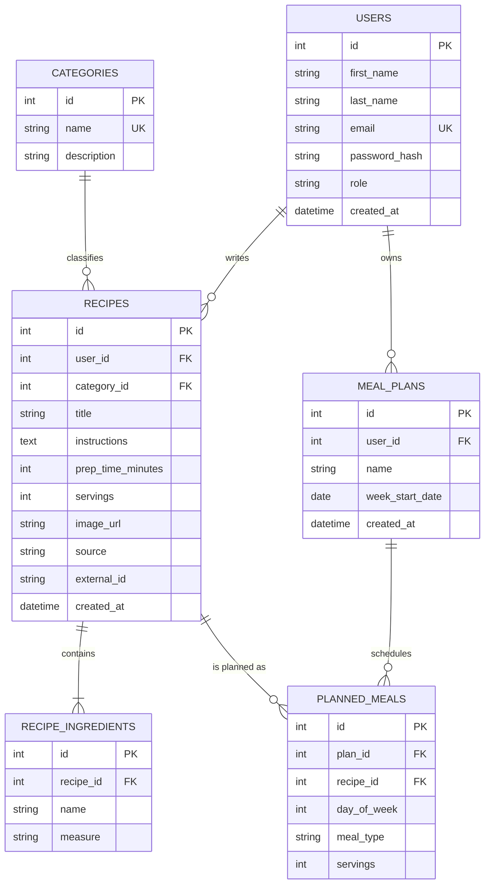

# ForkCast: Entity-Relationship Diagram

## Relationships

| Relationship | Meaning |
|---|---|
| users 1—N recipes | A user writes many recipes; each recipe has one author |
| categories 1—N recipes | A category contains many recipes; each recipe has one category |
| recipes 1—N recipe_ingredients | A recipe has one or more ingredients |
| users 1—N meal_plans | A user owns many weekly plans |
| meal_plans 1—N planned_meals | A plan contains many planned meals |
| recipes 1—N planned_meals | A recipe can be planned many times. Through `planned_meals`, plans and recipes form a many-to-many relationship. |

## Constraints

- `users.email` and `categories.name` are unique.
- `recipes`: unique on (`user_id`, `external_id`), so a user cannot import the same TheMealDB meal twice. `external_id` is empty for own recipes.
- `meal_plans`: unique on (`user_id`, `week_start_date`).
- `planned_meals`: unique on (`plan_id`, `day_of_week`, `meal_type`), so each slot holds one meal.
- Allowed values: `role` is `admin` or `user`; `source` is `own` or `mealdb`; `meal_type` is `breakfast`, `lunch`, `dinner` or `snack`; `day_of_week` is 1 to 7.
- Ranges: `prep_time_minutes` 1 to 600, `servings` 1 to 20.

## Deletion rules

- Deleting a user deletes their recipes and plans (cascade).
- Deleting a recipe deletes its ingredients (cascade).
- Deleting a plan deletes its planned meals (cascade).
- A recipe used in a plan cannot be deleted (restrict).
- A category that has recipes cannot be deleted (restrict).